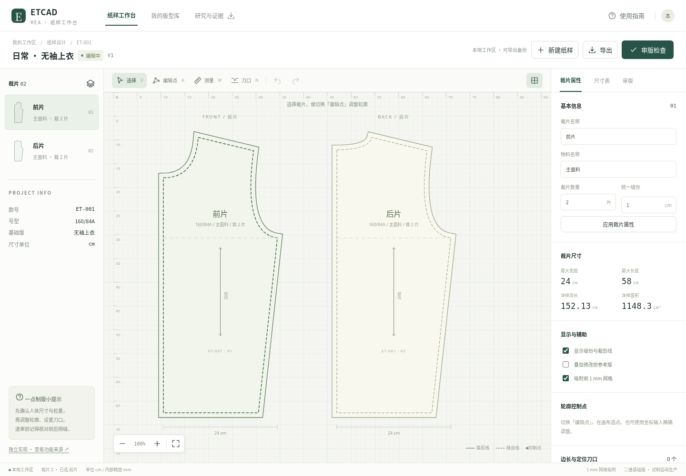

# ETCAD-rea 中文纸样工作台

面向中文用户的独立二维服装纸样工具：**新建 → 编辑 → 尺寸核对 → 送审 → 确认**。依据 ETCAD 公开手册与官方更新记录实现；没有声称已分析 ETCAD 二进制或复制其内部算法。



## 启动

Node.js 20 或更高版本，无需 `npm install`。

```sh
npm start
```

打开 <http://localhost:4173>。可用 `PORT=5173 npm start` 更换端口。

## 已实现

- 无袖上衣、A 字裙基础版；中文款名、款号、号型、物料和裁片数量。
- 厘米输入、毫米几何；尺寸驱动前后片，保留手动点位及曲线控制点偏移。
- SVG 点与曲线控制点拖动、坐标输入、两点测量、刀口、统一缝份预览、缩放与参考版叠加。
- 撤销/重做、本地多项目保存、JSON 导入导出、带 100 mm 校准线的毫米尺寸 SVG 导出。
- 轮廓交叉/退化检查、侧缝长度核对；按裁片记录意见，送审锁定、解决意见后确认、退回修改。
- 导出当前版本的审版 JSON 报告；桌面与手机布局。

快捷键：`V` 选择，`A` 编辑点，`M` 测量，`N` 刀口，`Ctrl/Cmd+Z` 撤销，`Ctrl/Cmd+Shift+Z` 重做，`Ctrl/Cmd+S` 本地保存。

数据只保存在当前浏览器的 localStorage。导出 JSON 才是可迁移备份；没有登录、服务端同步、多人身份审批或云备份。

## 研究文档

- [ETCAD 版本与更新目录](docs/research/ETCAD-VERSIONS.md)：官方产品代际、14 条官方更新、第三方历史年款名称、来源及覆盖边界。
- 可下载的五页文档：[Word](docs/research/ETCAD-Versions.docx) · [PDF](docs/research/ETCAD-Versions.pdf)。
- [ETCAD 功能证据与实现映射](docs/research/ETCAD-EVIDENCE.md)：新建、编辑、测量检查及审版的证据，逐项区分文档事实和本项目设计。
- [机器可读更新目录](docs/research/releases.json)。
- [真实运行验证](docs/verification/VERIFICATION.md)。

## 范围

这是一版可运行、可编辑、可保存的功能起点。基础版公式是演示用独立公式；曲线缝份由离散采样偏移近似，未实现工业级角处理、复杂凹角修复或逐边缝份。投产前须由版师复核、实测打印校准线并试样。

本版不读写 ET 专有的 `.prj` / `.ets` / `.plc` / `.plw`，没有实现多号型放码、3D 试衣、自动排料、工业 DXF/PLT 或裁床输出。审版锁定仅为本地工作流状态，不是防篡改或企业权限系统。

ETCAD 是布易科技的独立产品，本项目并非其官方软件。REA 的 MIT 许可适用于 REA 工具本身，并不授予 ETCAD 源码或素材许可。本项目运行时没有嵌入 REA 或 ETCAD 代码。

## 验证

```sh
npm test
npm run check
# 另一个终端先 npm start；需要 Python Playwright 与 Chromium
npm run verify:ui
# 一键测试、启动临时服务器、UI 检查和清理
npm run verify
```

`/verify` skill 已从用户的 dot-pi 仓库复制到 [.agents/skills/verify/](.agents/skills/verify/SKILL.md)，并保留原有 references/evals。项目运行配方见 [etcad-rea.md](.agents/skills/verify/references/etcad-rea.md)。这只安装了文件，未声称注册原生聊天斜杠命令。
