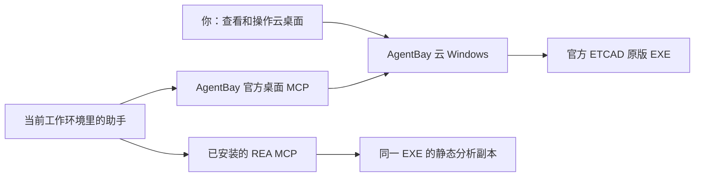

# 原版 ETCAD：用 AgentBay 云 Windows 连接、部署和验收

**可以走 AgentBay 的 Windows 云电脑路线。原版 EXE 在真正的 Windows 上运行，你远程看到和操作它的桌面。** 本轮已准备私有安装包、安装 SDK、实现并实测本地 MCP 桥接；尚未创建云 Windows 会话，原版验收结论是 **BLOCKED**。

你需要做的账户步骤：打开 [AgentBay 国内控制台](https://agentbay.console.aliyun.com/)，登录后在「总览 → API KEY → 管理」中创建或选择一个可用 Key。把它作为运行环境的 `AGENTBAY_API_KEY` 私密配置交给程序，**不要把 Key、密码或短信验证码贴到聊天或 GitHub**。本轮阿里云账户接口返回 `UNAUTHORIZED / requires reauthentication`，环境也未配置这个 Key；公开文档查询可用。阿里云应用的 OAuth 登录与 AgentBay SDK Key 是两种不同的连接方式，重新登录应用不保证自动提供 SDK Key。

## 你实际使用的是什么



REA 负责查看程序的内部结构；AgentBay 官方 MCP 负责真实 Windows 的截图、点击、拖动、输入和文件操作。这两个用途分开验收。两端 EXE 的 SHA-256 必须相同。现有 Linux 环境中的 REA 6.9.0、Ghidra 12.1.4 与 JDK 21 已完成真实 MCP 静态调查，证据见 [原生调查报告](../research/native/REA-ETCAD-ANALYSIS.md)。

这条路线不需要把 EXE 转成 WASM。Vercel 可以放网站入口；原 EXE 的运行和桌面连接由 Windows 服务提供。本工具包验证一次短时云桌面操作流程，尚未提供长期、多用户的原版 ETCAD 托管服务。

## 官方资料确认了什么

| 所需能力 | 官方依据 | 当前状态 |
| --- | --- | --- |
| 创建 Windows 云电脑 | [SDK 核心概念](https://www.alibabacloud.com/help/en/agentbay/developer-reference/core-concept.md) 的 `CreateSessionParams(image_id="windows_latest")` 示例 | 文档确认；本账户未创建 |
| Windows 程序启动与鼠标键盘 | [官方 SDK](https://github.com/agentbay-ai/wuying-agentbay-sdk)、[Windows MCP 工具](https://www.alibabacloud.com/help/en/agentbay/developer-reference/computer-use-windows-server-2022) | 已核对安装包中的真实 API；云端未调用 |
| 会话最长 30 分钟、闲置 5 分钟释放 | 已安装 SDK 0.22.3 的 `LifecyclePolicy` 与 [对应源文件](https://github.com/agentbay-ai/wuying-agentbay-sdk/blob/36eedd88ad2176e419a0b6a77c7b486dab9851d6/python/agentbay/_common/params/lifecycle_policy.py)；单位是分钟 | 参数已在本地实际构造；云端执行未验证 |
| 查看/管理 API Key 和会话日志 | [控制台总览](https://help.aliyun.com/zh/agentbay/overview1) | 需要用户账户登录 |
| 原 EXE 来源和身份 | [厂商学习版下载页](https://www.etsystem.cn/News/detail.html?id=1039) | 已下载、解包并校验 |
| REA 在 Windows 上的分析支持 | [REA Windows Ghidra P0](https://github.com/morluto/rea/blob/f14e9a1d282a7155c32f260730f5881d2c3e6c83/docs/providers/windows-ghidra-p0.md) | 实验性、有限的只读分析；不代表 Windows GUI 自动化 |

`windows_latest` 是可变别名。第一次跑通时要记录控制台里的实际镜像 ID、Windows 构建、位数与依赖；之后用账户可访问的固定镜像 ID 重跑。Windows 是否包含所需的 32 位组件、老版图形接口是否正常，都必须在真实会话中观察。

## 费用与可点击的桌面链接

[国内计费说明](https://help.aliyun.com/zh/agentbay/product-overview/agentbay-billing-instructions) 当前列出 CPU **0.12 元/核/小时**、内存 **0.05 元/GB/小时**，运行中的闲置会话也计费。例如实际规格若为 4 核 8 GB，单算计算资源约 **0.88 元/小时，半小时约 0.44 元**；这不是本账户的报价，镜像规格、地区、网络、存储及实际账单仍需核对。官方计费页的旧示例和单价表存在差异，优先核实当前控制台报价。

[新用户试用说明](https://help.aliyun.com/zh/agentbay/product-overview/new-user-trial-instructions) 写明：符合首次试用和实名认证条件的账号可领取 **100 积分**，云电脑消耗 **1 积分/小时**；是否符合、是否已领取，本轮没有查询到。

Basic 权益包本身免费，但计算资源仍按量计费。官方把 **GetLink 外部端口访问**列为 Pro/Ultra 高级功能，国内还要求企业实名认证。脚本不会调用 GetLink，也不会购买或升级套餐。普通创建结果若返回 `resource_url`，会保存到本地私密的 `connect-private.txt`；若不返回，需在控制台核查桌面连接能力，不能承诺 Basic 一定有可点击的远程桌面 URL。

## 已准备的脚本

| 文件 | 做什么 |
| --- | --- |
| [prepare.py](../../tools/agentbay/prepare.py) | 校验官方 RAR，安全解包，用未修改的应用文件生成私有 ZIP |
| [cloud.py](../../tools/agentbay/cloud.py) | 本地 stdio MCP：创建/释放云 Windows、上传、部署、截图、鼠标、键盘、诊断与下载项目证据 |
| [Deploy-Learning.ps1](../../tools/agentbay/Deploy-Learning.ps1) | 在 Windows 校验上传包和每个应用文件，记录 OS/硬件/EXE 身份；不宣告界面 PASS |
| [check.py](../../tools/agentbay/check.py) | 本地真实 MCP 协议检查、SDK 契约核对、篡改拒绝和缺少凭据时的阻止行为 |
| [save_key.py](../../tools/agentbay/save_key.py) | 在终端隐藏输入 Key，存入明确指定的私密文件；不打印 Key |

供应商安装包、字体、DLL、纸样及带凭据的桌面链接只保留在私有工作目录，不放进这个仓库。

### 在新的工作环境复现准备步骤

需要 Python **3.11+**（准备脚本使用 `hashlib.file_digest`）与 Linux 的 libarchive；Ubuntu 包名通常为 `libarchive13`。应用运行环境仍是云 Windows。本地 Python 只负责控制。

```bash
python3 -m venv /workspace/work/agentbay-runtime/venv
/workspace/work/agentbay-runtime/venv/bin/python -m pip install -r tools/agentbay/requirements.txt

# 输出目录必须尚不存在；每次都验证官方 RAR 和原 EXE 的哈希。
python3 tools/agentbay/prepare.py --out /workspace/work/agentbay-runtime/official-payload

# 不联网创建实例，也不收费；返回当前 readiness 和 BLOCKED 状态。
/workspace/work/agentbay-runtime/venv/bin/python tools/agentbay/cloud.py \
  --payload /workspace/work/agentbay-runtime/official-payload/et-learning-private.zip \
  --run-dir /workspace/work/agentbay-runtime/runs

# 检查桥接器。它会刻意移除子进程的 Key，确保本地检查不创建收费会话。
/workspace/work/agentbay-runtime/venv/bin/python tools/agentbay/check.py \
  --payload /workspace/work/agentbay-runtime/official-payload/et-learning-private.zip \
  --out /workspace/work/agentbay-runtime/check-evidence
```

也可给准备脚本传 `--archive /已有路径/ET_PSV.rar`，复用下载；SHA-256 不匹配会拒绝继续。重新打包只改变容器格式，242 个应用文件逐个保持原字节。

### 接到 Codex 的 MCP

已有 REA 项目注册保留。将下面的表添加到本机的项目 `.codex/config.toml`，按实际机器调整绝对路径；不要在该文件里填写 Key。当前 VM 中已做这项本地注册，另用真实 stdio 客户端验证过协议；当前聊天无法靠写文件热加载新 MCP 工具。

```toml
[mcp_servers.etcad_windows]
command = "/workspace/work/agentbay-runtime/venv/bin/python"
args = ["/workspace/work/ETCAD-rea/tools/agentbay/cloud.py", "--serve", "--payload", "/workspace/work/agentbay-runtime/official-payload/et-learning-private.zip", "--run-dir", "/workspace/work/agentbay-runtime/runs", "--region", "cn-hangzhou", "--image", "windows_latest", "--key-file", "/workspace/work/agentbay-runtime/agentbay-key"]
startup_timeout_sec = 30
tool_timeout_sec = 600
```

Key 可以通过启动客户端时的私密环境继承，也可以用终端隐藏输入，保存到上面明确指定的私密文件：

```bash
python3 tools/agentbay/save_key.py --file /workspace/work/agentbay-runtime/agentbay-key
```

输入时不会显示内容，也不会把 Key 放进命令历史。这个桥接器只读取 `AGENTBAY_API_KEY` 或 `--key-file` 明确指定的文件，不会搜索其他服务的凭据或把 Key 写入日志。文件尚不存在时仍可做 readiness 检查。修改配置或添加 Key 后重新打开可信任项目的 MCP 客户端，观察实际工具列表。

桥接器提供 12 个工具；服务启动和 `cloud_plan` 不创建云实例。账户连接后按顺序调用：

1. `cloud_plan`：核对 SDK 0.22.3、Key 是否存在、私有包是否存在、地区和镜像。
2. `cloud_create`：只创建一个带有本项目标签的会话；记录 session ID 和请求 ID，设置 5 分钟闲置释放、最长 30 分钟，并读取云端真实 MCP 工具目录。确认该镜像确实提供本轮需要的原生工具；SDK 里存在方法不等于每个镜像都有对应服务。需要更长调查时，先保存证据再开下一轮。
3. `cloud_deploy`：上传私有包，确认环境是真 Windows，逐文件核验，调用官方 `computer.start_app` 启动原版。返回 `LAUNCH_REQUESTED` 仍不代表窗口可用。
4. `desktop_screenshot`、`desktop_windows`：检查原版窗口或实际缺失组件错误。截图自动保存为本地 PNG。
5. 用 `desktop_click`、`desktop_drag`、`desktop_keys`、`desktop_type` 执行下面的原生验收；每步留证。坐标以本轮实际截图为准。
6. `collect_project` 只收集本次应用目录下的文件；用它保存本轮新建、编辑和重开用的 PRJ。不会自动改变 `acceptance.json` 为 PASS。
7. `cloud_stop`：显式删除本桥接器创建的会话，保存 `cleanup.json`。正常客户端 EOF 也会尝试删除；若失败，记录 session ID，去控制台核查并释放。会话删除不等于证明持久化 Context 中的数据已删除。

先到控制台确认 API Key 的权限、会话配额、计费和可用 Windows 镜像。不要把本地 MCP 端口开放到公网。本桥接使用 stdio，不监听网络端口。

### 如果一定要把 REA 也装在云 Windows

优先复用已经验证的 Linux REA 做同字节静态分析，可以减少云会话安装时间。REA 的 Windows 路线另有实验性边界，以下是上游配置指引，**尚未在本账户的云 Windows 执行**：

```powershell
# 前提：上游支持的 Node 版本、Ghidra 12.1.4、完整 JDK 21 已安装到本地磁盘。
npm install --prefix C:\ETCAD-tools\rea rea-agents@6.9.0
$env:GHIDRA_INSTALL_DIR = 'C:\ETCAD-tools\ghidra_12.1.4_PUBLIC'
$env:JAVA_HOME = 'C:\ETCAD-tools\jdk-21'
$env:REA_ANALYSIS_PROVIDER = 'ghidra'
node C:\ETCAD-tools\rea\node_modules\rea-agents\scripts\rea.mjs doctor --json
node C:\ETCAD-tools\rea\node_modules\rea-agents\scripts\rea.mjs providers --json
```

根据 [REA 官方 Windows 指南](https://github.com/morluto/rea/blob/f14e9a1d282a7155c32f260730f5881d2c3e6c83/docs/providers/windows-ghidra-p0.md)，需要 Windows x64、固定本地 NTFS/ReFS 目标与临时卷、匹配的原生 addon；Node 支持 22.x ≥22.23.4、24.x ≥24.22.1 或 26.12.1+。先实际跑 `doctor/providers` 再注册 MCP，不能把复制配置当成可用。REA 的运行进程捕获指南当前仅覆盖 Linux/macOS，不承诺 Windows 运行时等价支持。

## 怎样才算这次原版验收 PASS

| 步骤 | 必须实际看到/读回的证据 |
| --- | --- |
| 身份与启动 | Windows OS/构建/位数、镜像 ID、原 EXE 哈希、窗口与进程；启动错误必须保存 |
| 新建 | 原程序中新建纸样文档，并画出一个可辨认的闭合轮廓；截图与操作记录 |
| 打开 | 从原版文件对话框打开 `sample_dir/sample0.prj` 等随包纸样，看到实际内容 |
| 编辑 | 改一个点或曲线；记录原位置、操作和变化后的形状，测量关联尺寸 |
| 检查/复核 | 实际打开并使用可用的测量或检查功能，保存结果；人工复核不等于有多人审批系统 |
| 保存 | 另存到本次目录，下载实际 PRJ，记录大小、哈希和本轮唯一标记 |
| 重开读回 | 关闭文档，重新打开刚保存的文件，确认修改后的点/曲线/尺寸仍在；复制一个原样例不能代替保存成功 |
| 邻近异常 | 取消打开或取消编辑后原项目不变；保存前后保留对照 |
| 清理 | 导出证据后释放会话，记录服务回执并在控制台核查没有本轮遗留运行会话 |

**学习版的保存能力尚未经过真实 Windows 验证。** 之前解码的学习版主菜单没有发现常规「保存/另存为」入口，但这还不能证明实际界面必然禁用。如果原生运行确实禁止保存，应保留原始提示，完整保存/重开验收仍未通过；使用合法授权、允许保存的版本继续验证。不得用改 EXE 或解除限制来制造 PASS。

以后重跑时，按 [项目 Windows 验证配方](../../.agents/skills/verify/references/rea-agentbay-windows.md) 保留同一候选的完整证据。SDK 成功、进程存在、一张菜单截图或静态反编译均不能单独证明该流程通过。

## 本轮已经验证到哪里

见 [本轮检查报告](evidence/KIT-VERIFICATION.md)、[机器可读结果](evidence/kit-checks.json) 与 [真实本地 MCP 回复](evidence/mcp-responses.json)。当前本地支持性检查通过，原版 Windows UI、保存、重开都 **NOT_RUN**；没有创建云会话，没有产生本工具包的云桌面计算费用，也没有部署原版到 Vercel。
