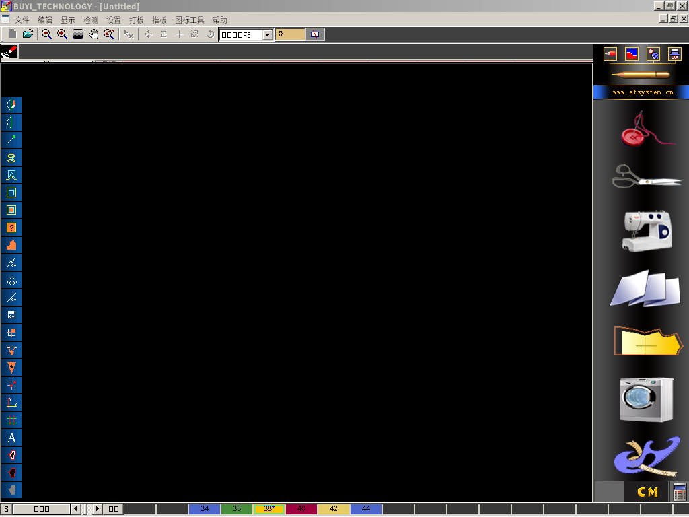

# ET-CAD 界面里有哪些工具？

对象：官网公开学习版 `ETCOM_PSV.exe`，文件版本声明 `2009.1.1.0`。以下工具来自程序菜单资源的实际解码，供普通读者了解用途；不等同于最新商业版的完整功能表，也不代表已逐个点击验收。

| 你想做什么 | 原版菜单里的工具例子 | 普通话解释 |
| --- | --- | --- |
| 画出布片轮廓 | 矩形框、直线/曲线、丁字尺、连续线、圆角处理 | 画衣服前面、后面、袖子要裁成的形状 |
| 修改形状 | 曲线编辑、端修正、平移、旋转、镜像、局部调整 | 把领口弧线改一改、移动一块布、复制左右对称的部分 |
| 把画好的线变成布片 | 提取裁片、裁片合并、裁片属性 | 把轮廓组成可单独管理的布片，填写名称和用途 |
| 留出缝衣服的边 | 自动加缝边、缝边宽度、缝边刷新、缝边角处理 | 在边上多留一点布，方便缝起来；不是把衣服本身做大 |
| 做衣服细节 | 刀口、扣子、扣眼、拉链缝合、衣褶、省道、转省 | 标对齐位置、纽扣孔，处理褶子和让衣服贴身的收折 |
| 处理袖子和领子 | 袖综合调整、一枚袖、两枚袖、插肩袖、西装领 | 针对不同袖子和衣领形状进行调整 |
| 改成不同尺码 | 尺寸表、号型名称、进入推板、放码点、规则修改 | 在一个版型基础上处理不同大小；行业里常叫“推板/放码” |
| 量一量，查问题 | 皮尺测量、长度测量、两点测量、角度测量、拼合检查、安全检测 | 看尺寸、核对两条要缝在一起的边是否相配 |
| 看图、管理文件 | 打开文档、双文档拷贝、调入底图、缩放、参考层、自定义工具组 | 打开旧纸样、对照图片、查看细节、调整工作台 |

打板程序和排料程序是不同 EXE。本包另有 `ETMark_PSV.exe`；不要把打板菜单表当成排料程序的全部按钮。

完整命令 ID、菜单路径和文件偏移在 [gui-command-catalog.json](gui-command-catalog.json)。该文件由 REA 已定位并计算哈希的 Windows MENU payload 补充解码得到；父 Evidence 为 `ev_e537a92dd0cfa81ad9e6dd6e1ce9bb3a299381b553211ab05a1ca1b0c7be12ab`。功能边界与实际代码追踪见 [REA 调查](REA-ETCAD-ANALYSIS.md)。

本次共解码 326 个菜单项，含 230 个不同命令 ID；其中包含重复入口及内部菜单，不能称作 230 个已验收按钮。

这是在浏览器兼容环境中启动原 EXE 的真实截图。后续操作存在黑屏，详见 [WASM 兼容实验](wasm/WASM-FEASIBILITY.md)，不能把这张图理解为原版已经能在线正常制版。
