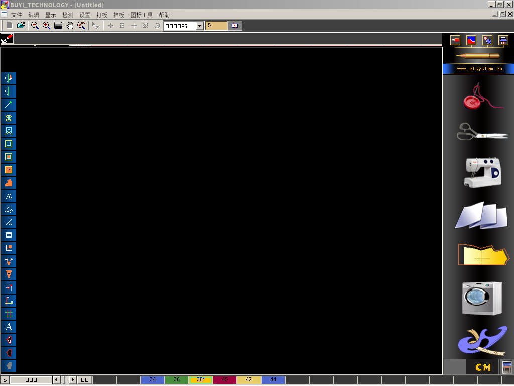
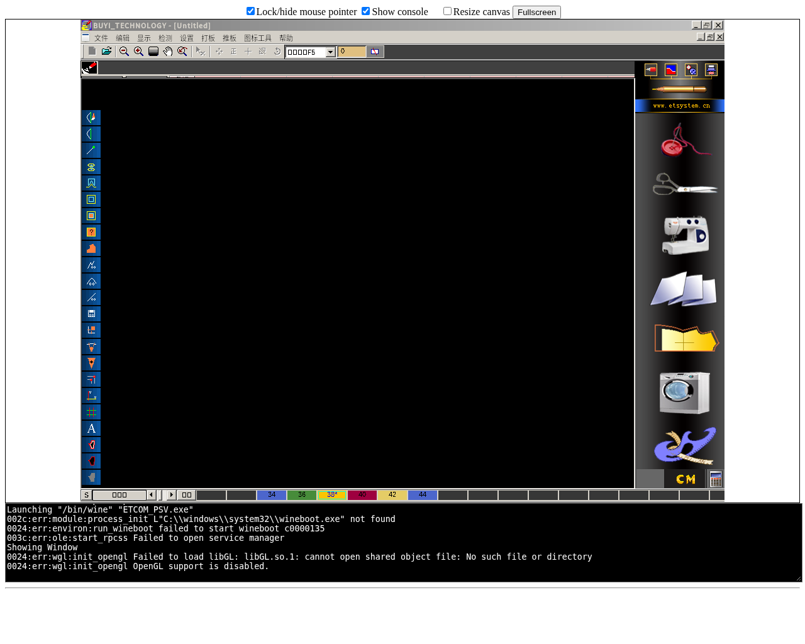

# 原版 ET-CAD 能直接放进浏览器吗？

日期：2026-11-16。对象是官网公开学习版 `ETCOM_PSV.exe`，不是本仓库独立编写的中文工作台。

**当前结论：原版浏览器兼容验收 FAIL，尚未部署到 Vercel。** 已实际在 WebAssembly 模拟环境里启动原 EXE，看到原版工具栏和中文菜单；点击打开工具后出现黑屏，未完成打开纸样、绘图、保存与重开。启动画面不构成功能验收。

## 普通人需要知道的区别

Vercel 可以托管网页和 WASM 文件。WASM 是浏览器能运行的一种程序格式；本次下载的是依赖 Windows 界面和运行库的 EXE。当前没有 ET-CAD 原始源码，不能直接把它重新编译成保留原 GUI 的 WASM。

因此本次实际尝试的是：**网页 → WASM 模拟器 → Wine 兼容环境 → 原版 ET-CAD EXE**。ET-CAD 主程序的 SHA-256 始终是 `a2c0df89a37d064b3c00b975a7e0cca68c3b2ad17a5e920d9fddc0ac3daa0aba`，没有把本项目的简化网页当成原版程序。

## 实际画面

下面是 Playwright 直接截取原程序所在 canvas 的真实画面，没有重新绘制界面。中文字体与菜单可见；它只证明启动到了工作台。

随后在同一类配置下点击屏幕上的打开图标，工作区连同工具栏变黑，未出现可用的文件打开结果：

## 做了哪些实际尝试

| 配置 | 实际结果 |
| --- | --- |
| 官方 Boxedwine `26R1.0` Web 包，单线程，内置 Wine 6 | 自带 SkiFree 控制样例打开了窗口。ET 首次启动报缺少 `MFC42u.DLL`、`MSIMG32.dll`、`OLEPRO32.DLL`，主 EXE 导入失败 |
| 官方 Wine 11 精简文件系统 + 微软运行库 | 取得原版学习版启动图；随后出现窗口类共享会话错误，未完成主工作台验收 |
| Wine 6 + 应用目录中的 VC6 DLL + MSIMG32 转发 DLL | 可打开原工作台；MSIMG32 的实际依赖由 REA MCP 查到，为 `TransparentBlt`、`GradientFill`，转发到 Wine 已有的 GDI 函数 |
| 多线程 Wine 6 + 中文字体及字体注册 | 中文菜单正常显示；真实鼠标点击打开工具后黑屏，未完成打开与绘图 |
| 更新 Boxedwine 源码 `1dbddbb…`，Emscripten `7.0.0`，官方 web filesystem `v39` | 编译成功并实际运行；浏览器记录图形参数错误和黑色显示面。未完成原程序功能验收 |
| 更新引擎的隐藏 GL 窗口/画布尺寸补丁 | 成功构建，修复了实验补丁自身的一处初始化错误后重试，仍为黑色显示面；补丁未获得功能 PASS |

显示设置实验还尝试过把两个配置文件现有的 `OpenGL=TRUE` 改成 `FALSE`，没有解决问题。其所属段为 `CPathSetDlg`，不能认定它就是主画布的 GDI/GL 切换开关；最终 GUI 截图使用的应用配置恢复为原始内容。

官方 `26R1` 包的 readme 明确说该 Web 构建不支持 OpenGL/Direct3D。原程序确有 OpenGL 导入，实际日志也报告 `OpenGL support is disabled`。更新构建仍失败的具体修复尚未证明；不能仅凭这条日志认定所有黑屏都已找到唯一原因。

## 证据与精确候选

- [下载来源、哈希、引擎候选和截图哈希](runtime-provenance.json)
- [原版界面启动记录](native-gui-startup.json)；[点击打开后的记录](native-open-failure.json)
- [最初的导入失败](initial-import-failure.json)；[更新引擎的运行结果](current-engine-failure.json)
- [REA MCP 查到的 DLL 依赖](rea-dependency-evidence.json)
- [微软官方 VC6 安装包的静态提取记录](microsoft-runtime-extraction.json)：校验 upstream Winetricks 所列 SHA-256，未执行安装程序
- [原始 JSON 文件哈希索引](raw-evidence-index.json)
- [未通过验收的引擎实验补丁](failed-emulator-experiment.patch)：保留恢复点，不是已修好的产品补丁

完整软件包、源码构建、试验配置与日志留在 VM 的 `/workspace/work/et-wasm/`、`/workspace/work/boxedwine-reference/` 和 `/workspace/work/emsdk/`。仓库没有重新分发 ET 软件包或微软运行库。

## 部署状态与可行路线

已通过连接查询发现可用的 Vercel 团队，并确认该团队下没有现成的 ETCAD 项目。本轮没有创建项目、发布预览或生产部署，也没有产生可宣称为可用原版的 URL。

| 想达到的结果 | 当前状态 |
| --- | --- |
| 原 Windows EXE 直接变成可用 WASM 网站 | 当前不可直接交付；需要原始源码的移植，或继续修复并验收模拟运行环境 |
| 保留原 Windows GUI | 浏览器模拟路线仍需兼容工作；另一个架构是实际 Windows 环境运行程序，由网页远程显示和操作，这需要持续运行的后端机器 |
| 本仓库的独立中文网页工作台 | 已是浏览器代码，可另行部署到 Vercel，无须把 Windows EXE 转成 WASM；它的功能范围和文件格式与原版不同 |

此结论是针对上述实际样本和候选，不是“所有 Windows 应用都不能在 WASM 运行”的断言。

## 验证范围与清理

遵循项目从 dot-pi 复制的 verify：真实 Chromium + 鼠标/键盘 + canvas 像素观察。虽然若干候选没有 JavaScript 异常，原版操作仍失败，因此没有判 PASS。没有完成的绘图、保存、重开继续保持未验证。

本仓库独立工作台的 9 个验证源码文件哈希均未改变；原有 8 个测试和 12 组浏览器场景属于原工作台的既有记录，本轮没有借用它们证明原版移植成功。

本轮 REA MCP 的 2 条依赖 Evidence 已导出并 reset，stdio 客户端正常退出；自启浏览器上下文均已关闭，本地试验服务器已停止。VM 内的安装与实验文件保留，便于后续继续定位，而不需要重新下载。

参考：[Boxedwine Web 文件系统说明](https://github.com/danoon2/Boxedwine/blob/1dbddbb292a2119390d0c2af825b4460c0593854/docs/How-To-Create-FileSystem-For-Web.md) · [Emscripten 构建与浏览器要求](https://github.com/danoon2/Boxedwine/blob/1dbddbb292a2119390d0c2af825b4460c0593854/project/emscripten/buildInstructions.md) · [Vercel 静态输出](https://vercel.com/docs/build-output-api/primitives)
