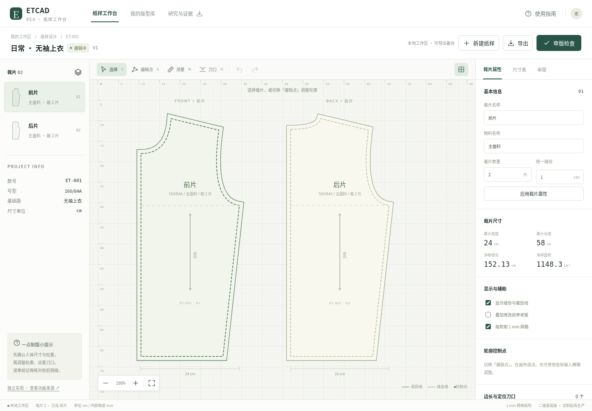
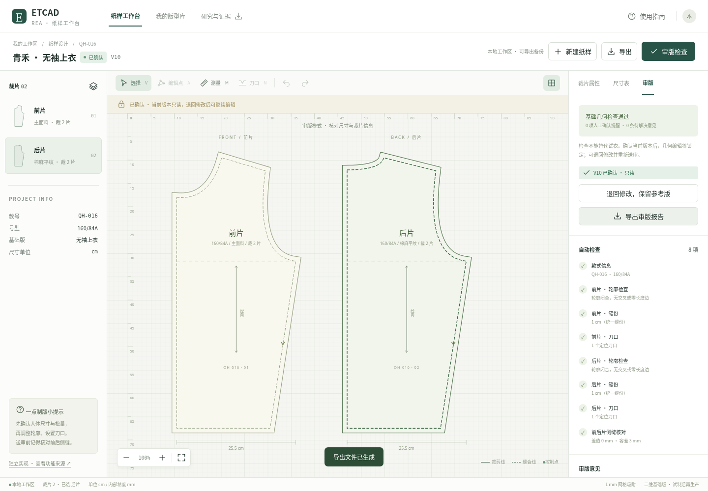
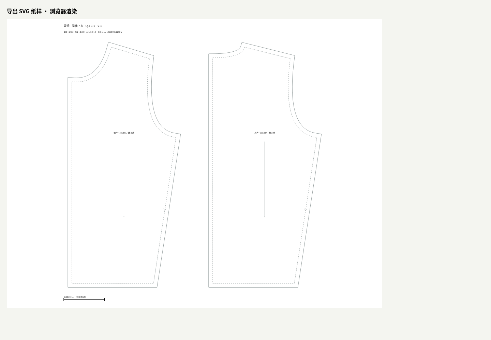
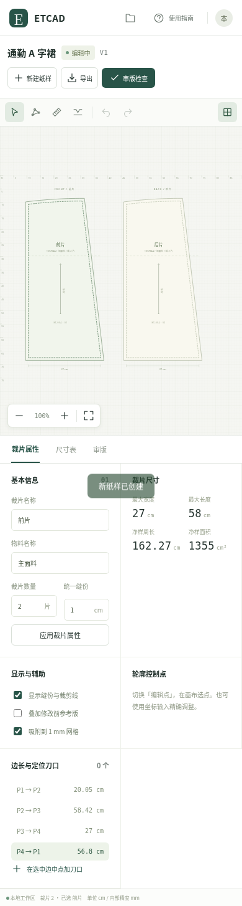

# ETCAD-rea 交付验证

**结论：PASS**，适用于本仓库的本地中文二维纸样工作台。验证日期：2026-11-16。未部署线上站点；本地验证不代表 ETCAD 原生客户端或某个 ETCAD 发行版本已经实机验证。

候选是本次首个提交所包含的运行时源码。逐文件 SHA-256 在 [source-manifest.json](source-manifest.json) 中；验证运行前保存哈希，运行后再次核对，提交前再次核对。将最终 Git commit 中对应文件与此清单对照即可定位精确候选，避免在报告内反向嵌入自身提交哈希。

使用从 dot-pi 复制的 [verify skill](../../.agents/skills/verify/SKILL.md) 和新建的 [ETCAD-rea 项目配方](../../.agents/skills/verify/references/etcad-rea.md)。原 skill 的 9 个文件逐字节保持一致，来源与哈希见 [SOURCE.json](../../.agents/skills/verify/SOURCE.json)。

## 本地检查

完整入口为 `npm run verify`，退出码 0。它在新启动的 `http://127.0.0.1:4187` 上执行真实表面检查，并在最后终止自启服务器。

| 命令或检查 | 结果 | 原始证据 |
| --- | --- | --- |
| `npm test` | 8/8 通过，无跳过 | [commands.log](commands.log) |
| `npm run check` | 退出码 0 | [commands.log](commands.log) |
| `npm run verify:ui` | 12 组端到端场景通过 | [runtime-report.json](runtime-report.json) |
| HTTP 服务边界 | HTML/JS MIME 正确；隐藏 Git 路径、跨目录路径、缺失 JS 均 404 | [http-checks.json](http-checks.json) |
| 完整执行与清理 | PASS；自启服务器已停止 | [execution.json](execution.json)、[app-server.log](app-server.log) |

单元测试覆盖基础版几何、曲线长度、已知方形的缝份偏移、参数更新保留手动偏移、轮廓相交、侧缝差异、审版冻结、坏文件输入和 SVG 内容转义。它们支持真实 UI 验证，没有替代真实 UI。

## 真实交互路径

Python Playwright 驱动系统 Chromium；使用真实鼠标/键盘事件，没有调用内部应用函数或用 `element.click()` 注入操作。

1. 打开中文工作台，观察 SVG 前后片，保存初始截图。
2. 新建中文命名上衣，填写胸围，读回本地保存记录，确认 cm→mm 转换。
3. 键盘选点并输入坐标；鼠标拖动轮廓点和曲线控制点；撤销、重做；确认几何数据变化。
4. 更改胸围，确认两片同时更新，手动领口偏移保持。
5. 在画布真实点击两点，观察距离读数。
6. 前后片增加刀口，编辑中文物料，独立读回保存数据。
7. 增加审版意见，送审，确认未解决意见阻止通过；解决意见后通过；下载并读取绑定当前 revision 的审版报告；刷新后仍只读。
8. 实际下载 JSON 和 SVG，读取文件，浏览器渲染已下载的 SVG，观察毫米尺寸及 100 mm 校准线。
9. 退回修改，将前片侧缝故意拉长；检测报错并禁用送审。
10. 导入之前导出的 JSON，再刷新，确认几何和已确认状态完整恢复；导入损坏 JSON，确认当前项目没有被替换。
11. 从版型库重新打开原项目，确认新建/导入没有覆盖原项目。
12. 在 390 px 视口创建裙版，检查无页面横向溢出，手机入口能打开全部本地项目。

最终运行：无未捕获异常、无浏览器 console error、无失败请求或 4xx/5xx 资源响应。独立临时浏览器上下文已关闭，未触碰用户真实浏览器资料。

## 画面与导出证据

### 工作台

### 当前版本审版确认

### 下载 SVG 的实际渲染

[实际导出的 SVG](exported-pattern.svg) 及 [HTTP 渲染预览](export-preview.html)。

### 手机布局

## 资料文档检查

版本目录包含 14 个唯一官方更新标签与 10 个历史年份系列，区分官方名称和第三方标签；所有行保留来源。Word 包含 5 张表，已转换为 5 页 PDF，检查标题、中文字体、表格、跨页重复表头与正文。各更新标签均在 Word 表格中出现。Markdown 相对链接逐项检查。

第一轮资料结论来自厂商公开文档。第二轮已取得官方学习版二进制，并通过 REA MCP 完成限定范围的静态调查，见 [原生调查验证](../research/native/VERIFICATION.md)。这没有运行 ETCAD Windows 界面；完整历史构建表、用户实际版本和完整内部几何算法仍未验证。第一轮应用运行时源码未改变，原始浏览器验证证据继续对应上述逐文件哈希。

## 发现与修正

- 首轮浏览器脚本用“关闭”匹配到了两个按钮，已改为准确的对话框页脚定位；未减少场景范围。
- 本环境禁止 `file://`；导出 SVG 改为经受控本地 HTTP 预览渲染，没有关闭浏览器策略。独立 SVG 文档截图曾超时，改为真实 `` 加载已下载文件，并确认图像完成解码后截图。
- 代码审查补充了轮廓非相邻边接触检查，以及静态服务器规范化路径白名单。
- Word 初次转换出现表格版面异常；重新生成原生表格并复查五页 PDF 后交付。

这些问题已在最终验证候选上修正。基础版公式、近似曲线缝份和本地审批状态的范围保持在 README 中明确说明，没有把测试通过扩展成工业投产或原生 ETCAD 兼容性结论。
